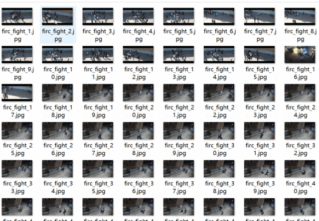
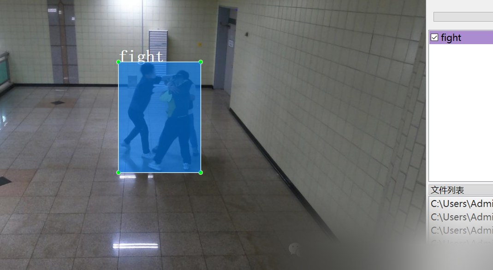

# Fight Behavior Detection Dataset VOC+YOLO format with 7327 images in 2 categories

Dataset format: Pascal VOC format + YOLO format (txt file without split path, only containing jpg images and corresponding VOC format xml files and yolo format txt files)
Number of images (number of jpg files): 7327
Number of annotations (number of xml files): 7327
Number of annotations (number of txt files): 7327
Number of annotation categories: 2
Annotation category names: ["fight", "no fight"]
Number of bounding boxes for each category:
- Fight bounding boxes = 5430
- No fight bounding boxes = 3266
Total bounding boxes: 8696
Labeling tool used: labelImg
Annotation rules: Draw a rectangle around the category
Important note: There is no guarantee regarding the accuracy or weights of the trained model. The dataset provides accurate and reasonable annotations only.

Image Preview:

Annotation example:

## Payment

Here is a pay link on Stripe ( https://buy.stripe.com/3cs8yP7sY87d0vu9AB ). Please contact me lonlonago@foxmail.com after funding $89, and I will send you a complete data files , thank you!

